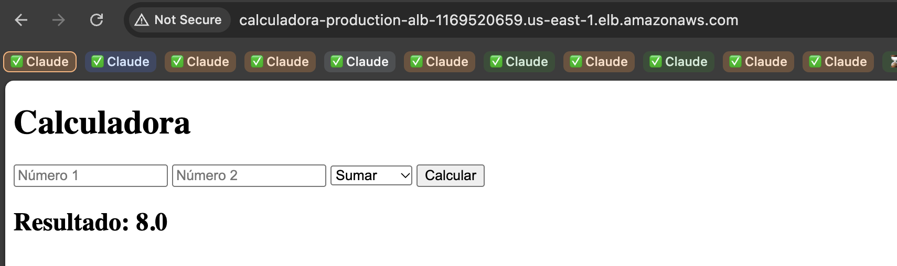
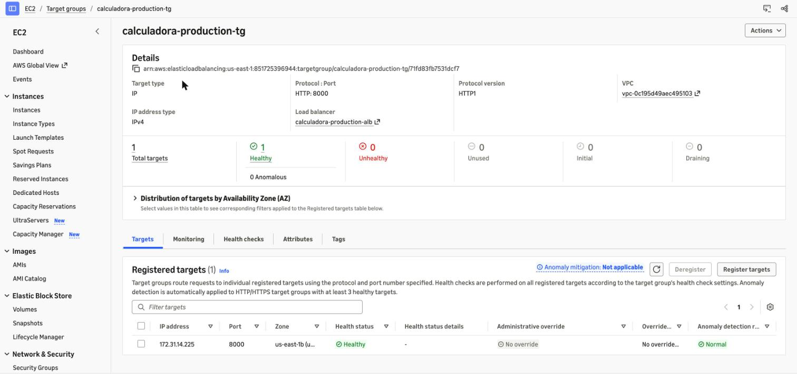

# cicd-pipeline-python-cd

Calculadora web (Flask) con un pipeline de CI/CD en GitHub Actions: integración continua
(Black, Pylint, Flake8, pytest, Selenium, SonarCloud y publicación en Docker Hub) y
despliegue con Terraform en AWS ECS (Fargate), primero en Staging y luego en Producción.

## Integrantes

Jose Miguel Blanco

| Integrante | Usuario de GitHub | Rol |
|---|---|---|
| Jose Miguel Blanco | [@Josem0117](https://github.com/Josem0117) | Propietario del repositorio |

## Evidencias

- Ejecución del merge (5 jobs en verde, con la aprobación de Producción):
  https://github.com/Josem0117/cicd-pipeline-python-cd/actions/runs/43622750056
- Pull Request de las operaciones nuevas (`potencia` y `modulo`):
  https://github.com/Josem0117/cicd-pipeline-python-cd/pull/2
- URL de Staging: http://calculadora-staging-alb-228594420.us-east-1.elb.amazonaws.com
- URL de Producción: http://calculadora-production-alb-1169520659.us-east-1.elb.amazonaws.com

Las dos URL dejan de responder cuando se destruye la infraestructura (sección 10 del
taller).

Producción con una de las operaciones nuevas:



Target group de Producción con el target `healthy`:



## Respuestas

### 1. Flujo completo del pipeline

El artefacto que recorre el pipeline es la **imagen Docker**, etiquetada con el SHA del
commit. Se construye una sola vez en `build-and-test` y esa misma imagen es la que se
despliega en Staging y en Producción; los jobs de despliegue reciben su nombre completo
por el output `image_uri`.

- **`build-and-test`**: verifica el formato (Black), genera los reportes de Pylint y
  Flake8, ejecuta las pruebas unitarias y de componente con cobertura mínima del 80 %,
  valida el código de Terraform (`fmt` y `validate`), construye la imagen, la levanta
  en un contenedor y corre las pruebas de aceptación con Selenium contra ese
  contenedor. Después envía el análisis a SonarCloud y espera el Quality Gate. Solo en
  `main` publica la imagen en Docker Hub con las etiquetas del SHA y `latest`.
- **`deploy-staging`**: con Terraform (workspace `staging`) crea o actualiza la
  infraestructura en AWS y despliega la imagen en ECS Fargate. Entrega la URL del
  Load Balancer.
- **`test-staging`**: espera a que `/health` de Staging devuelva el SHA del commit y
  ejecuta las pruebas de aceptación con Selenium contra el ambiente real.
- **`deploy-production`**: igual que Staging, con el workspace `production`. Requiere
  la aprobación de un revisor en el ambiente `production`.
- **`smoke-test-production`**: espera el SHA en `/health` de Producción y ejecuta las
  pruebas de humo.

Qué valida cada prueba: las **unitarias**, cada función de la calculadora por
separado; las de **componente**, la aplicación Flask completa (rutas, formulario y
plantilla) sin servidor; las de **aceptación**, la aplicación como la usa una persona,
con un navegador real; las de **humo**, que el despliegue responde y que la versión
desplegada es la esperada.

### 2. Terraform frente a la consola, y por qué el estado va en S3

**Ventajas de Terraform:** la infraestructura queda escrita en archivos versionados en
Git, se revisa en un Pull Request como cualquier cambio y se puede recrear idéntica las
veces que haga falta. Los dos ambientes salen del mismo código y solo cambia una
variable, lo que evita diferencias accidentales entre ellos. `terraform plan` muestra
qué va a cambiar antes de aplicarlo y `terraform destroy` elimina todo sin dejar
recursos olvidados que sigan cobrando.

**Desventajas:** hay que aprender HCL y el modelo de estado; para un cambio único y
pequeño es más lento que hacer clic en la consola; si alguien modifica un recurso a
mano, el estado deja de coincidir con la realidad; y un error en el código se replica
en todos los ambientes.

**El estado en S3:** el estado es el registro de qué recursos creó Terraform. Cada
ejecución del pipeline corre en una máquina nueva que se descarta al terminar; si el
estado quedara en el disco local, la siguiente ejecución no sabría que la
infraestructura ya existe e intentaría crearla otra vez. En S3 el estado es compartido
y persistente, el versionado del bucket permite recuperar una versión anterior y
`use_lockfile` impide que dos ejecuciones lo modifiquen al mismo tiempo. No se sube a
Git porque puede contener valores sensibles.

### 3. Ventajas y desventajas de un entorno de Staging

**Ventajas:** se prueba la imagen real en una infraestructura igual a la de Producción
antes de que la vean los usuarios. Ahí aparecen los fallos que no se ven en la máquina
del desarrollador ni en el contenedor del runner: permisos, red, health checks,
variables de entorno o el comportamiento detrás del Load Balancer. Si algo falla, el
pipeline se detiene y Producción sigue con la versión anterior.

**Desventajas:** duplica el costo de la infraestructura, alarga el pipeline (en este
proyecto, varios minutos por el despliegue y las pruebas) y hay que mantenerlo
parecido a Producción para que sus resultados sean confiables. Aun así nunca es
idéntico: no tiene el tráfico ni los datos reales.

Es un intercambio entre velocidad y seguridad: se entrega más despacio a cambio de
reducir la probabilidad de romper Producción.

### 4. Diferencia entre `test-staging` y `smoke-test-production`

`test-staging` ejecuta la suite completa de aceptación con Selenium: abre un navegador,
llena el formulario y comprueba el resultado de cada operación, incluidos los casos de
error. Es exhaustiva y envía datos de prueba a la aplicación, por eso se corre en
Staging: su función es decidir si la versión puede pasar a Producción.

`smoke-test-production` ejecuta dos comprobaciones rápidas por HTTP, sin navegador: que
la página principal carga y que `/health` responde `ok` con el SHA esperado. No prueba
la funcionalidad en detalle; confirma que el despliegue quedó en pie y con la versión
correcta, sin generar carga ni operaciones de prueba sobre el ambiente que usan los
usuarios.

### 5. Dos prácticas que le faltan al pipeline

**HTTPS y análisis de seguridad de la imagen.** Los Load Balancers atienden por HTTP,
así que el tráfico viaja sin cifrar, y nadie revisa si la imagen base o las
dependencias tienen vulnerabilidades conocidas. Se implementaría con un certificado de
AWS Certificate Manager y un listener HTTPS en Terraform (con redirección desde HTTP), y
agregando a `build-and-test` un paso que escanee la imagen (por ejemplo con Trivy) y
falle ante vulnerabilidades críticas antes de publicarla.

**Monitoreo y alertas después del despliegue.** Las pruebas de humo solo miran el
instante posterior al despliegue. Si la aplicación empieza a fallar una hora después,
nadie se entera. Se implementaría con alarmas de CloudWatch sobre los errores 5xx del
Load Balancer y sobre los targets `unhealthy`, con notificación por SNS, y un tablero
con latencia y tasa de errores.

### 6. Experiencia de cada integrante

**Jose Miguel Blanco:** lo más valioso fue ver el recorrido completo de un cambio,
desde el Pull Request hasta Producción, sin pasos manuales salvo la aprobación. Los
problemas que aparecieron fueron de integración más que de código: SonarCloud bloqueó
el Quality Gate por hallazgos de seguridad en Terraform, y las pruebas de aceptación
que pasaban contra el contenedor fallaron contra Staging porque Chrome no abre por
defecto sitios públicos sin HTTPS. Ese segundo fallo mostró para qué sirve Staging: se
detectó ahí y nunca llegó a Producción. También quedó clara la limitación de las
credenciales temporales del laboratorio, que obligan a renovar los secretos en cada
sesión.

### 7. ¿Entrega Continua o Despliegue Continuo?

Con la aprobación manual antes de Producción el pipeline implementa **Entrega
Continua**: cada cambio integrado en `main` llega automáticamente a Staging y queda
listo para liberarse, pero la decisión de pasar a Producción la toma una persona. Sin
esa aprobación sería Despliegue Continuo.

Antes de aprobar se revisó en Staging que `test-staging` terminara en verde, es decir,
que `/health` devolviera el SHA del commit y que las nueve pruebas de aceptación
pasaran, incluidas las de `potencia`, `modulo` y el error de módulo por cero.

Si el health check falla, el Load Balancer marca la tarea como `unhealthy` tras tres
fallos seguidos y deja de enviarle tráfico. ECS detiene esa tarea y lanza otra para
mantener una en ejecución. Durante un despliegue, la tarea anterior no se retira hasta
que la nueva pasa el health check, así que el servicio no se cae; y si las tareas
nuevas siguen fallando, el *circuit breaker* de ECS revierte el servicio a la última
versión que funcionaba. En el pipeline eso se ve como un `terraform apply` fallido o
como el paso de espera que nunca encuentra el SHA nuevo en `/health`.

## Ejecución local

```bash
python -m venv venv && source venv/bin/activate   # Windows: venv\Scripts\activate
pip install -r requirements-dev.txt
python -m app.app                                  # http://localhost:5000
pytest --ignore=tests/test_acceptance_app.py --ignore=tests/test_smoke_app.py --cov-fail-under=80
```
